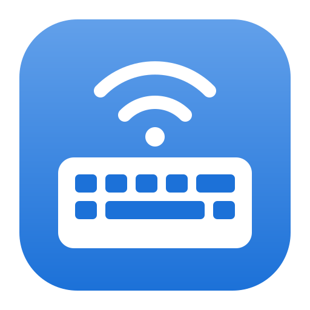

<p align="center">
  
</p>

<h1 align="center">Debonair</h1>

<p align="center">
  <strong>Your computer, as a Bluetooth keyboard and mouse.</strong>
</p>

<p align="center">
  Debonair turns a small, inexpensive microcontroller board into a Bluetooth keyboard and
  mouse. Plug it into your computer, pair it with a tablet, a TV, a phone or another computer,
  and type and point on that device with your computer's own keyboard, mouse or trackpad.
</p>

<p align="center">
  <a href="https://github.com/ryanpetris/debonair/releases/latest"></a>
  
  <a href="LICENSE"></a>
</p>

<p align="center">
  <a href="https://github.com/ryanpetris/debonair/releases/latest"><b>Download</b></a>
  &nbsp;·&nbsp;
  <a href="#get-started">Get started</a>
  &nbsp;·&nbsp;
  <a href="#supported-boards">Supported boards</a>
  &nbsp;·&nbsp;
  <a href="docs/building.md">Build from source</a>
</p>

## Why Debonair

- **Nothing to install on the other device.** It sees an ordinary Bluetooth keyboard and mouse.
- **Smooth trackpad scrolling.** Scrolling is sent in fractions of a wheel detent to devices that
  support high-resolution scrolling, such as Windows and Linux. A trackpad pinch zooms.
- **Keys your computer keeps for itself.** Send Ctrl+Alt+Delete, Alt+Tab, the Super key and media
  keys from buttons or your own shortcuts, and build your own key combinations and typed text.
  Full screen capture also captures system shortcuts where the operating system allows it.
- **Just a keyboard, just a mouse, or both.** Turn either off and the adapter appears to devices as
  only the other.
- **Pair once.** Pairings and the adapter's settings are stored on the adapter.

## What you need

- One of the [supported boards](#supported-boards).
- A Linux x86-64 computer to run the Debonair app.

## Supported boards

| Board | Bluetooth | Firmware download |
| --- | --- | --- |
| Raspberry Pi Pico W | Low Energy | `debonair-firmware-<version>-pico_w.tar.gz` |
| Raspberry Pi Pico 2 W | Low Energy | `debonair-firmware-<version>-pico2_w.tar.gz` |
| Waveshare RP2350B-Plus-W | Low Energy | `debonair-firmware-<version>-waveshare_rp2350b_plus_w.tar.gz` |
| Seeed Studio XIAO ESP32S3 | Low Energy | `debonair-firmware-<version>-xiao_esp32s3.tar.gz` |

Each board also has a debug archive, `debonair-firmware-<version>-<board>-debug.tar.gz`, which adds
restarting into the bootloader from the app.

## Get started

### 1. Install the app

Download `debonair-desktop-*-x86_64.AppImage` from the
[latest release](https://github.com/ryanpetris/debonair/releases/latest), make it executable with
`chmod +x` and run it. A tar archive is also available as `debonair-desktop-*-x64.tar.gz`; extract
it and run the included `debonair-desktop`.

To use the adapter without root, copy `50-debonair.rules` from the tar archive (or from `configs/`
in this repository) to `/etc/udev/rules.d/` and reconnect the adapter, or add yourself to the group
that owns `/dev/ttyACM*`: `uucp` on Arch Linux, `dialout` on Debian and Ubuntu. Log out and back in
after changing groups.

### 2. Flash the adapter

Download your board's firmware from the
[latest release](https://github.com/ryanpetris/debonair/releases/latest) and extract it.

**Raspberry Pi Pico W, Pico 2 W and Waveshare RP2350B-Plus-W**

1. Hold the **BOOTSEL** (or **BOOT**) button while plugging the board into USB. It appears as a
   USB drive.
2. If the board has held other firmware or data, erase its flash first with `picotool erase`
   (picotool 2.0 or later).
3. Copy the extracted `.uf2` file onto that drive. The board restarts as a Debonair adapter.

**Seeed Studio XIAO ESP32S3**

Hold **BOOT** while plugging the board in. If the board has held other firmware or data, erase its
flash first:

```sh
esptool --chip esp32s3 erase_flash
```

Then flash it with [esptool](https://docs.espressif.com/projects/esptool/) from the extracted
`xiao_esp32s3-esp-nimble-esp-idf` folder, using the offsets in its `flash.json`:

```sh
esptool --chip esp32s3 write_flash \
  0x0 bootloader.bin \
  0x8000 partition-table.bin \
  0x10000 debonair-xiao_esp32s3-esp-nimble-esp-idf.bin
```

[Erasing a board](docs/building.md#erasing-a-board) describes when a board's flash must be
erased.

### 3. Pair a device

1. Plug in the adapter and open **Debonair**. With nothing paired yet, the adapter is ready to
   pair; otherwise choose **Pair New Device** on the **Devices** page.
2. On the other device, open its Bluetooth settings and choose **Debonair**.
3. If the adapter's **Pairing Security** is **Passkey**, type the passkey the device shows into the
   app. With **Passkey**, a device that cannot show a passkey cannot pair.

The adapter accepts new pairings only while it is pairing. A device that connects without pairing
or encrypting is disconnected after a short time, so it cannot keep paired devices out.

### 4. Type and point

Click the capture area on the **Control** page. Your keyboard and mouse now control the paired
device. Press and release **Ctrl+Alt** together to stop capturing, or press **Esc** when the mouse
is captured in a window. The release shortcut can be changed in **Settings**.

Use the buttons under the capture area, or their shortcuts, for key combinations such as
Ctrl+Alt+Delete (also **Ctrl+Alt+End** while capturing). **Type Clipboard** types the clipboard's
text with a US keyboard layout. Edit key combinations on the **Key Combinations** page.

## The adapter's status light

| Light | Meaning |
| --- | --- |
| Off | Bluetooth is starting, or the adapter's storage can't be opened |
| Short flash every two seconds | Waiting for a paired device |
| Fast blinking | Pairing |
| On | A device is connected |

## Learn more

- [Build from source](docs/building.md): toolchains, custom boards, checks and the simulator.
- [Serial API](docs/protocol/README.md)
- [Storage format](docs/storage-format.md)

Every release ships a `SHA256SUMS` file for verifying downloads.

## License

Debonair is released under the [MIT License](LICENSE). Third-party components keep their own
licenses; see [`notices/`](notices/).
